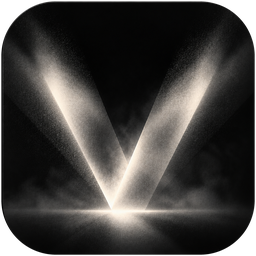
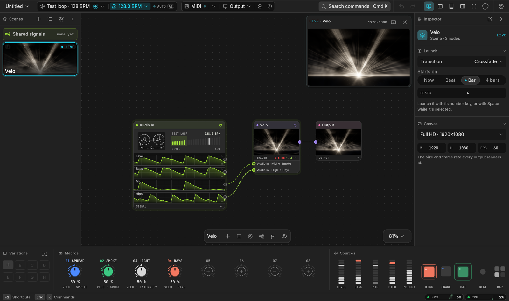
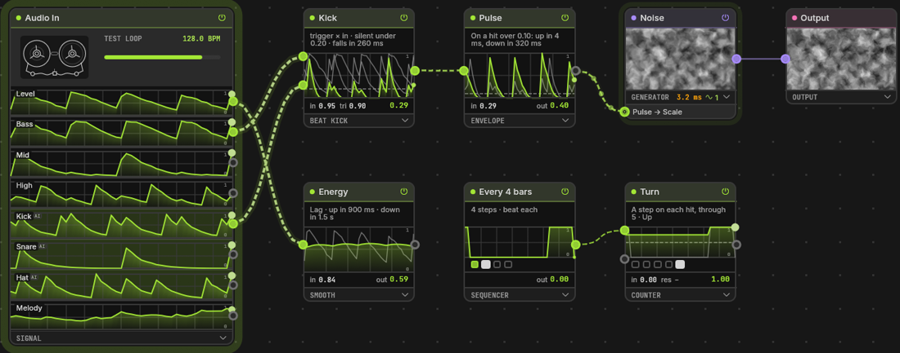
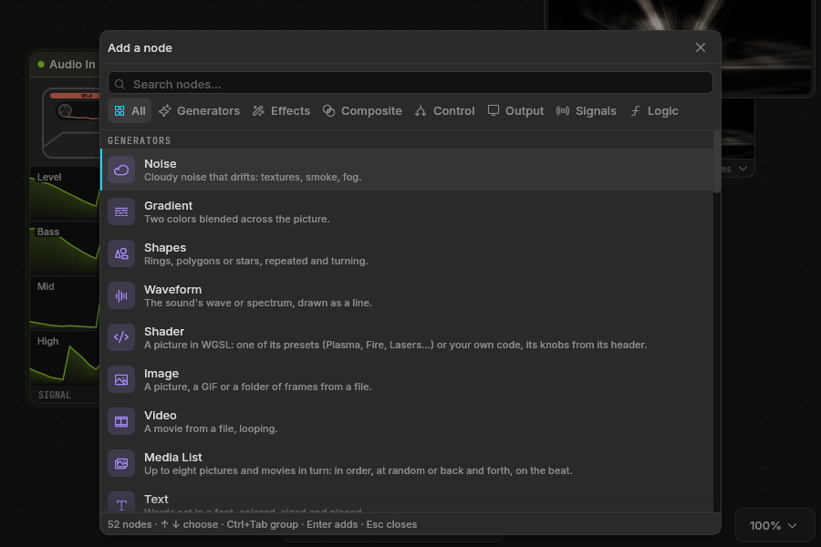
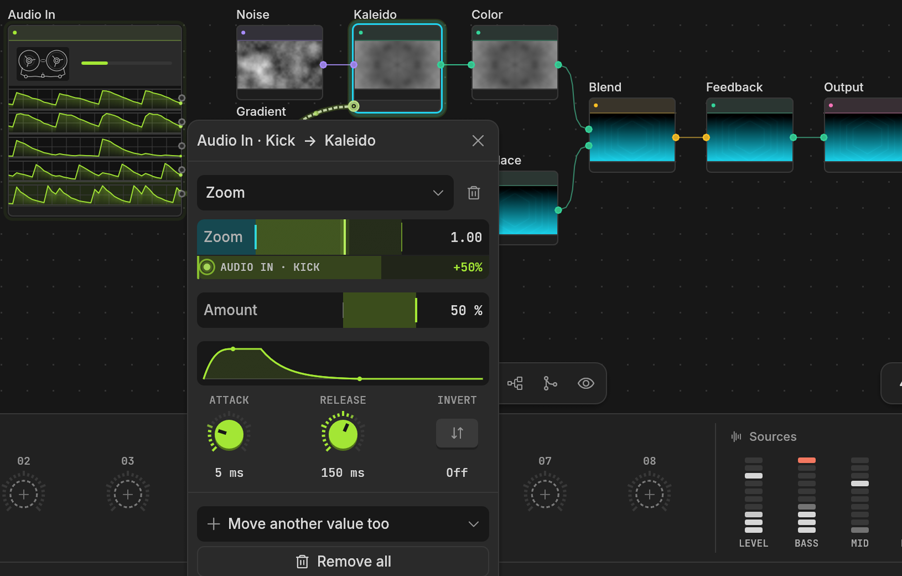
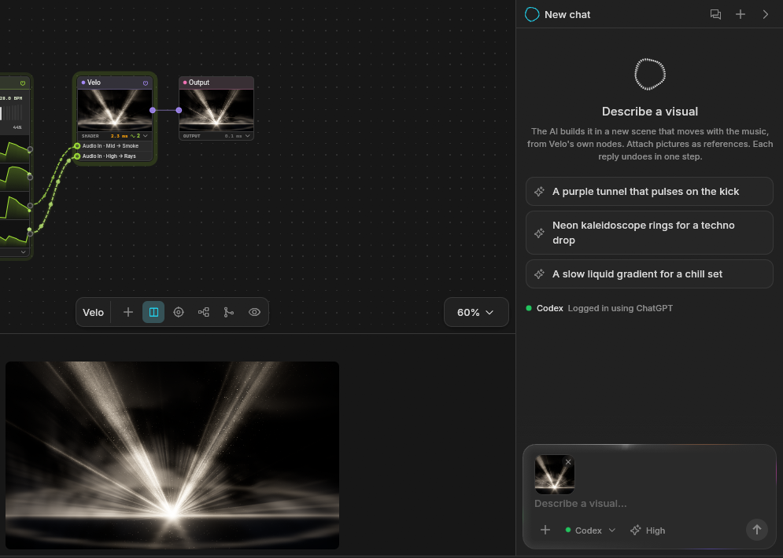
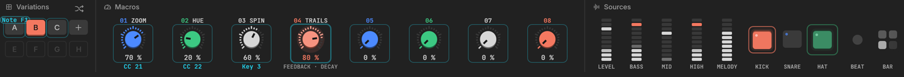

<div align="center">



<h1>Velo</h1>

<p><b>Sound shapes light.</b><br>
Live visuals played by the music, for VJs, DJs and anyone with a projector.</p>

<p>
<a href="https://github.com/g1lg1l/velo/releases/latest"><b>Download</b></a> ·
<a href="#five-minutes">Five minutes</a> ·
<a href="#features">Features</a> ·
<a href="#how-to-connect-an-ai">Connect an AI</a> ·
<a href="https://g1lg1l.github.io/velo/">Website</a> ·
<a href="#documentation">Docs</a>
</p>



<sub>Beta · Windows and macOS · free and open source · written in Rust</sub>

</div>

## What it is

Velo listens to the music and turns it into pictures, live. Each scene is a graph of GPU nodes, from noise and shapes to your own shaders, and any sound feature (the kick, the bass, the melody) can move any value. You play it with macros, scenes and a MIDI controller, send it fullscreen to a projector or to other apps, and if you'd rather describe a visual than patch it, an AI builds it from Velo's own nodes.

It opens on a demo that already moves with whatever the computer is playing.

## Download

**[Get the latest release](https://github.com/g1lg1l/velo/releases/latest)**

- **Windows:** run the installer. It installs for you alone, no admin needed. It isn't signed yet: if SmartScreen stops it, click **More info**, then **Run anyway**.
- **macOS** (Apple silicon, macOS 14 Sonoma or later): open the `.dmg` and drag Velo to Applications. The app isn't notarized yet, so the first time macOS refuses to open it: go to **System Settings → Privacy & Security** and click **Open Anyway**.
- **Linux:** build from source (below).

Once installed, Velo can check for a newer release and update itself in place.

## Five minutes

1. **Play some music.** Velo hears what the computer plays, no cables.
2. **Press `Tab`** on the canvas and pick a visual: type a few letters or browse a group, then Enter.
3. **Drag Kick** from the sources onto any slider: now the kick moves it.
4. **Output → a display:** it goes fullscreen there. `B` blacks it out, `F` freezes it.

Everything deeper (the patch, your own shaders, the AI) is there when you want it.

## Features

**Hears the music**
- The computer's own sound or any input, split into level, bass, mid, high, kick, snare, hat and melody.
- Kick, snare, hat and melody come from a small neural network that runs live ([how it was trained](crates/velo-audio/models/README.md)). Each hit's threshold is a line you drag on its graph.
- Tempo heard from the music, tapped, typed, or followed from Ableton Link or a MIDI clock.
- Any source onto any value, with its amount, attack, release and invert. Every generator and effect also has an **Automagic** knob that plays along by itself.

**Makes pictures**
- 60 nodes: generators (Noise, Gradient, Shapes, Waveform, Particles, Text, Image, Video, Media List), effects (Transform, Kaleido, Color, Blur, Feedback, Displace, Levels, Edges, UV Map, Lookup, Freeze, Time Machine, Key and more), compositing and switching (Blend, Mask, Merge, Switch, Grid, Layer Stack) and signals and logic (Beat Kick, LFO, Envelope, Sequencer, Sample & Hold, Random, Probe, Speed, Delay, Spring and more).
- 39 shader presets, from Plasma and Fire to Lasers, Fractal and V Beams, and 25 effect presets, from Glitch and VHS to LED Wall and God Rays.
- Your own WGSL or ISF shaders become nodes with knobs, rebuilt as you type or save. A broken shader keeps the last one that worked.
- Stills, GIFs, image sequences, HAP, H.264 and HEVC movies.

**Patches by hand**
- One graph per scene, TouchDesigner's way: every node shows its picture and what it costs the GPU.
- `Tab` opens the node menu, every node with its icon and a line on what it does. With a node selected, the new one is wired after it.
- A signal plugs into a jack on the card it moves. Its cable comes out like a wire: drop it on another card to move one of its values, or on nothing to remove it.
- `Alt`+drag across cables (or the toolbar's tie tool) ties them into a bundle. The arrange button lays the whole graph out left to right.

**Plays live**
- Scenes launched on the beat, the bar or four bars, with Cut, Crossfade, Wipe, Zoom, Glitch or Flash.
- Eight macros and eight variations per scene on the deck, and an autopilot that moves to the next scene every few bars, seconds, or on a drop, among the scenes you leave in it.
- Layer scenes: always on top of, or underneath, whatever is out (words, a logo, a background), over, added, screened or multiplied; launching one switches it on or off.
- MIDI learn on everything, with soft takeover; OSC in.
- Blackout, Freeze, and a test pattern for lining up the projector.

**Goes out**
- Fullscreen on any display, the picture's shape kept.
- **Spout** to Resolume, TouchDesigner, OBS or MadMapper; **NDI** to any computer on the network.
- The Output grades everything that leaves: exposure, contrast, saturation, hue, colorize, invert, vignette and fade to black.

**Builds with AI**
- Describe a visual, with pictures as references if you like, and Claude Code, Codex or a model behind an API builds it in a new scene. Ollama and LM Studio are found while they run; OpenAI, Anthropic, Gemini, OpenRouter and Groq take a key.
- Every reply is one undo step, and the AI leaves the live scene alone unless you allow it.
- Velo is also an MCP server (`velo-mcp`), so Claude Code, Claude Desktop, Cursor and other MCP clients can drive it from outside.

**Holds up for a whole set**
- A scene too heavy for the GPU slows down; it never piles up memory. Scenes kept ready to launch take at most half the video memory the system gives Velo: the rest stays the computer's.
- What nobody sees doesn't render: the inputs a Switch isn't showing (up to sixteen), a Blend's layers at no opacity, anything that doesn't reach the Output. A scene that picks among many looks costs the one on screen.
- The status bar shows what Velo takes, each with its last half minute: the engine's frames a second, CPU, memory, and on Windows the GPU and video memory. A chip turns amber when it runs high and red near the top.
- A driver reset, an unplugged projector or a lost audio input: Velo recovers and tells you.
- Autosave every minute, and crash recovery on the next start.
- A project is one `.velo` file. Export it with its media, or one scene of it as a project of its own, to hand to someone; import the scenes of another project into yours.

<table>
<tr>
<td width="50%"><br><sub><b>The patch.</b> Audio In's mid and high plug into the shader's jacks.</sub></td>
<td width="50%"><br><sub><b>The node menu.</b> 60 nodes, one key away.</sub></td>
</tr>
<tr>
<td width="50%"><br><sub><b>A mapping.</b> The kick moves Kaleido's zoom, with its own envelope.</sub></td>
<td width="50%"><br><sub><b>The AI panel.</b> Describe a visual, attach a picture, pick who answers.</sub></td>
</tr>
<tr>
<td colspan="2"><br><sub><b>The deck.</b> Variations, eight macros and every source, live.</sub></td>
</tr>
</table>

Not a 3D engine, a mapping suite or a timeline editor: see [what Velo is not](docs/product.md#3-what-it-is-what-it-is-not).

> **Making the beats too?** [Ravune](https://github.com/g1lg1l/ravune), from the same maker, is a modular DAW for deep sound design.

## How to connect an AI

There are two ways, independent of each other. In the AI panel, **How to connect an AI…** shows both with the paths of your own install, ready to copy.

**1. An AI inside Velo's panel.** Velo runs the `claude` or `codex` command, which keeps its own sign-in (being signed in to the Claude app isn't enough).

1. Install [Claude Code](https://claude.com/claude-code) and sign in from a terminal: `claude auth login`. For Codex: `npm install -g @openai/codex`, then `codex login`.
2. In Velo, pick Claude Code or Codex under the AI panel's box. **Test the connection** says whether it's signed in.

A local model (Ollama, LM Studio) or an API key works from the same menu: **Local or API model**.

**2. Velo driven from outside.** Claude Code, Claude Desktop, Cursor and other MCP clients talk to Velo through `velo-mcp`, the bridge installed next to Velo.

1. In Velo: **Preferences → AI and agents → Let agents use Velo**.
2. For Claude Code, run once (the path is where the Windows installer puts Velo):
   ```bash
   claude mcp add --scope user velo -- "C:\Users\<you>\AppData\Local\Programs\Velo\velo-mcp.exe"
   ```
   On macOS the bridge is `/Applications/Velo.app/Contents/MacOS/velo-mcp`.
3. Start a new Claude Code session: `/mcp` lists velo.

Other MCP apps take the same bridge in their list of servers, then a restart:

```json
{
  "mcpServers": {
    "velo": { "command": "C:\\Users\\<you>\\AppData\\Local\\Programs\\Velo\\velo-mcp.exe" }
  }
}
```

## Documentation

The user guide lives on the website: **[g1lg1l.github.io/velo](https://g1lg1l.github.io/velo/)**.

For contributors, the design docs:

| Document | Covers |
|---|---|
| [Product](docs/product.md) | What Velo is, its principles, budgets and interface |
| [Architecture](ARCHITECTURE.md) | Threads, crates, data flow, failure model, decisions |
| [Graph](docs/graph.md) | Nodes, ports, mappings, evaluation |
| [Audio](docs/audio.md) | Inputs, analysis, the drum model, tempo |
| [Rendering](docs/rendering.md) | The frame loop, media, outputs, Spout and NDI |
| [Control](docs/control.md) | MIDI, learn, OSC, clock sync |
| [Scenes](docs/scenes.md) | Scenes, macros, variations, launches |
| [Shaders](docs/plugins.md) | The shader node format, ISF |
| [Project format](docs/project-format.md) | Files, bundles, migrations |
| [Roadmap](ROADMAP.md) | What comes next |

## Build from source

```bash
cargo dev
```

`cargo dev` runs the app (`cargo dev -- show.velo` opens a project). It needs a Rust stable toolchain, cmake and a C++ compiler for Ableton Link, and on Windows LLVM (`winget install LLVM.LLVM`). `cargo run -p velo --no-default-features` builds without Link. On Linux, install the ALSA headers first (`libasound2-dev`). `cargo build -p velo-mcp` builds the MCP bridge.

See [CONTRIBUTING.md](CONTRIBUTING.md) for the checks a change has to pass.

## License

The app (`crates/velo`) is [GPL-3.0-or-later](LICENSE-GPL), because it ships with Ableton Link. The libraries (`velo-core`, `velo-engine`, `velo-audio`, `velo-mcp`) are [MIT](LICENSE-MIT) or [Apache-2.0](LICENSE-APACHE), at your option.
